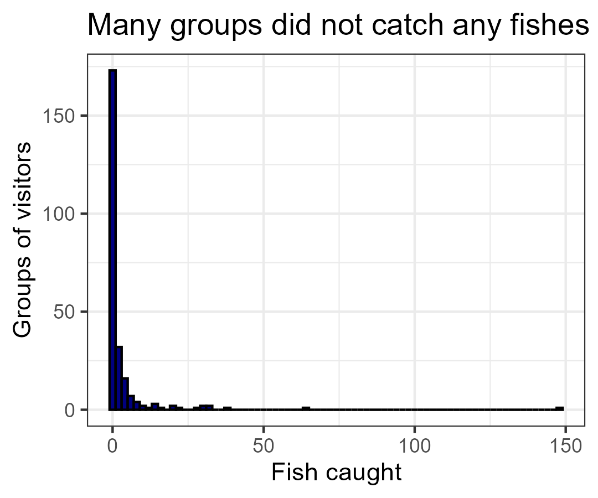
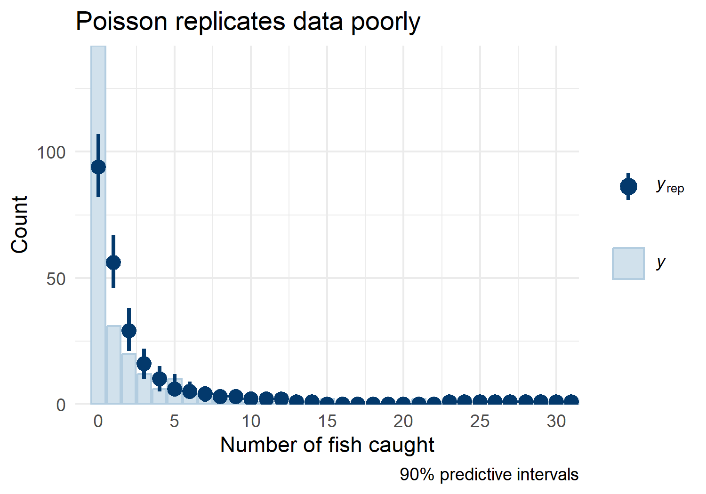
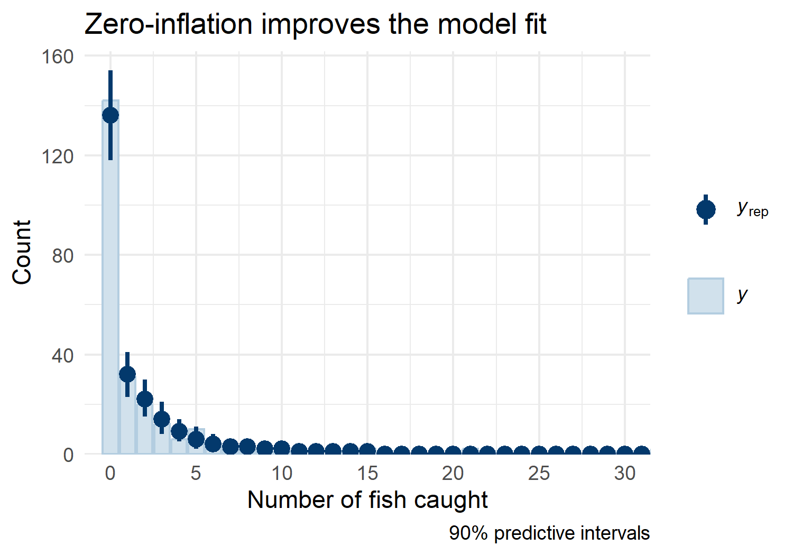
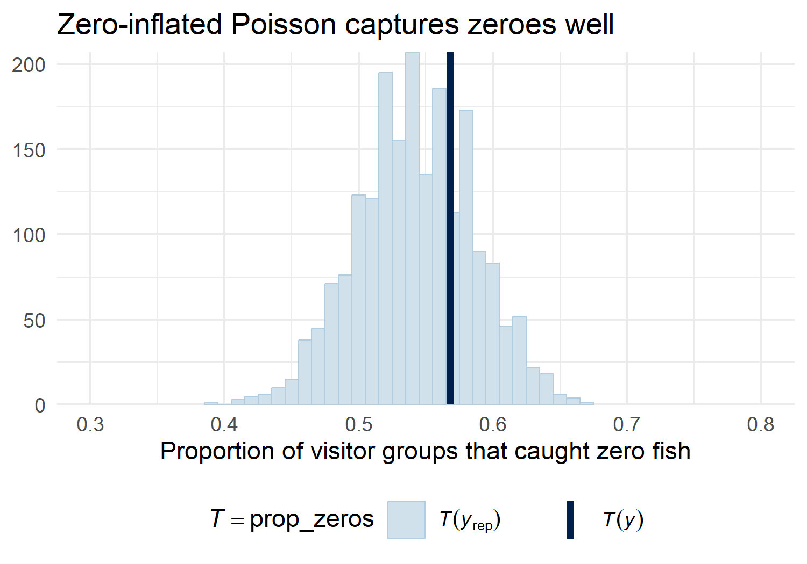
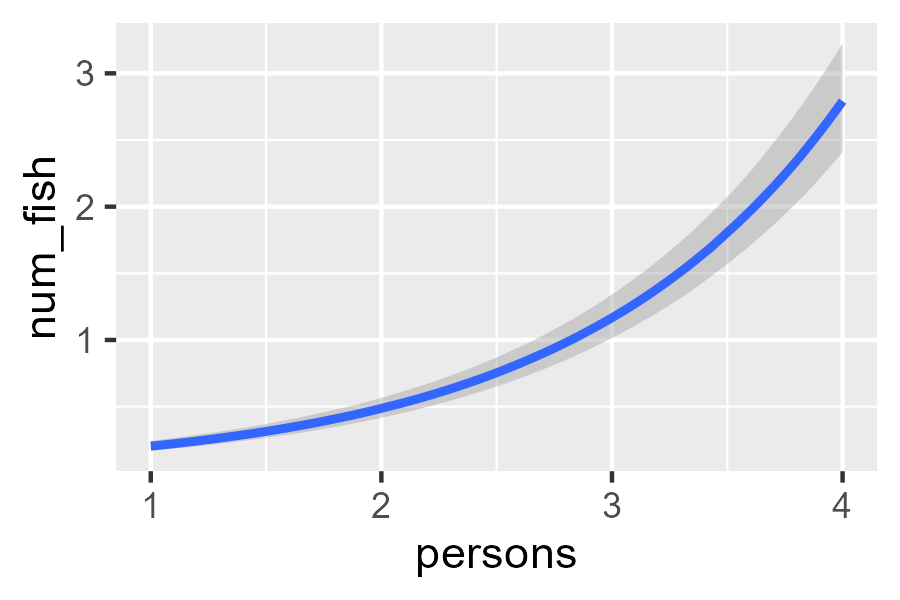
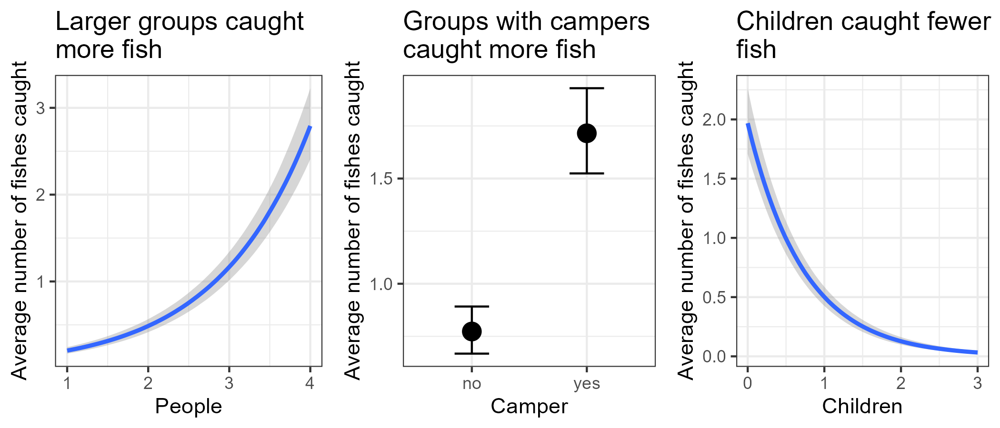

# Flexible GLMs

```{r Load libraries}
#| code-summary: "Load libraries"
#| output: false
library(dplyr)
library(ggplot2)
library(brms)
library(tidybayes)
library(bayesplot)
library(gridExtra) # For grouping plots; optional
options(brms.backend = "cmdstanr")
```

Now that we can write `brms`'s syntax and read its output, we can brave more
complicated models. Let us consider some data from park visitors, gathered by
UCLA[^orig-pois]. In their words:

> The state wildlife biologists want to model how many fish are
being caught by fishermen at a state park. Visitors are asked whether or not
they have a camper, how many people were in the group, were there children in
the group and how many fish were caught. Some visitors do not fish, but there
is no data on whether a person fished or not. Some visitors who did fish did
not catch any fish [...][^ucla-data]

[^orig-pois]: This data analysis is adapted from @burkner2025distmods.

[^ucla-data]: From @ucla2026zinf. It is unclear if the data are real or
simulated.

These data describe 250 groups of park visitors. For each group, we know how
many fish they caught (`count`), how many total people were in the group
(`persons`), how many of these were children (`child`), and whether the group
brought a camper vehicle (`camper`).

```{r Prepare fisher data}
fisher_df <- read.csv("https://paul-buerkner.github.io/data/fish.csv")
fisher_df <- fisher_df[, c("persons", "child", "camper", "count")]
names(fisher_df)[names(fisher_df) == "count"] <- "num_fish"
fisher_df <- fisher_df |>
  mutate(camper = as.factor(if_else(camper == 0, true = "no", false = "yes")))
summary(fisher_df)
```

Note that many visitor groups caught zero fish (see @fig-fish-hist). These
include zeroes from visitors that did not fish at all and zeroes from visitors
that did fish but caught nothing.

```{r histogram of fish caught}
#| code-fold: true
#| code-summary: Show histogram of fish caught
#| warning: false
#| fig-align: center
#| fig-width: 3.6
#| fig-height: 3
fish_hist <- ggplot(data = fisher_df, mapping = aes(x = num_fish)) +
  geom_histogram(binwidth = 2, color = "black", fill = "navyblue") +
  labs(
    title = "Many groups did not catch any fish",
    x = "Fish caught",
    y = "Groups of visitors"
  ) +
  theme_bw()
fish_hist
```

```{r save fish histogram}
#| include: false
#| eval: false
ggsave(
  filename = "images/fish-hist.png",
  plot = fish_hist,
  width = 3.6,
  height = 3
)
```

[{#fig-fish-hist fig-align="center" width=3.6in}](./images/fish-hist.png)

It is reasonable to think that larger groups were more likely to catch more
fish. Also, groups with campers likely stayed longer at the park, which would
give them more time to fish. And children tend to dislike sitting in silence for
long periods, so groups with more children may have fished less. These ideas
suggest using a model that can associate the average number of caught fish to
`persons`, `child`, and `camper`. We should also use a model that accounts for
the fact that the number of fish caught is a non-negative integer. A Poisson
regression is a relatively simple model that can fulfil both of these
requirements[^poisson-fish].

[^poisson-fish]: ...and gets extra credit because "poisson" means "fish" in
french.

An alternative to priors based on previous measurements is to use priors that
discard implausible values but still allow wide ranges for all
coefficients[^weak-inf-priors]. One common approach for this is to standardize
all numerical dependent variables and assign them all a Normal distribution
with mean zero and standard deviation 1[^rescale-alternative].

[^weak-inf-priors]: This type of priors are usually called "weakly-informative
priors".

[^rescale-alternative]: Another, uncommon approach is to rescale a prior distribution to match the scale of its corresponding variable.

```{r standardize covariates}
for (var_name in c("persons", "child")) {
  var_name_std <- paste0(var_name, "_std")
  fisher_df[[var_name_std]] <- scale(
    fisher_df[[var_name]],
    center = TRUE,
    scale = TRUE
  )
}
```

The code to prepare these rescaled priors is below.

```{r priors for fisher1}
prior_fisher1 <- prior(prior = std_normal(), class = "b") +
  prior(normal(0, 2.5), class = "Intercept")
```

Now we can fit our regression. The only novelty in the code below is the
argument `family`, which controls the type of model we want to fit---in this
case, a `poisson()`.

```{r fit poisson}
fit_fisher1 <- brm(
  formula = num_fish ~ persons_std + child_std + camper,
  data = fisher_df,
  family = poisson(),
  prior = prior_fisher1,
  chains = 4,
  cores = 4,
  iter = 1000,
  warmup = 500
)
```

Once again, our ESS and R-hats are all acceptable:

```{r summary fit_fisher1}
summary(fit_fisher1)
```

```
 Family: poisson
  Links: mu = log
Formula: num_fish ~ persons_std + child_std + camper
   Data: fisher_df (Number of observations: 250)
  Draws: 4 chains, each with iter = 1000; warmup = 500; thin = 1;
         total post-warmup draws = 2000

Regression Coefficients:
            Estimate Est.Error l-95% CI u-95% CI Rhat Bulk_ESS Tail_ESS
Intercept      -0.38      0.09    -0.55    -0.20 1.00     1163     1192
persons_std     1.21      0.04     1.13     1.30 1.00     1224     1162
child_std      -1.43      0.07    -1.57    -1.30 1.00     1400     1452
camperyes       0.93      0.09     0.76     1.11 1.00     1402     1181

Draws were sampled using sample(hmc). For each parameter, Bulk_ESS
and Tail_ESS are effective sample size measures, and Rhat is the potential
scale reduction factor on split chains (at convergence, Rhat = 1).
```

Before we examine the coefficients, we can check if our model can replicate the
overall pattern of fish caught. The function `pp_check()` can paint many types
of plots to illustrate how well our models fit the data. It asks us to define a
model to evaluate and the `type` of evaluation we want. `type = "bars"`
compares a barplot of the original data (shown as $y$ in clear blue) to the
predictive intervals obtained from the random draws in our model (shown as $y_{rep}$ in dark blue).

```{r check fit of fit_fisher1}
#| fig-align: center
#| fig-width: 5
#| fig-height: 4
fisher1_pred <- pp_check(
  object = fit_fisher1,
  type = "bars",
  ndraws = 600,
  prob = 0.9 # for 90% credibility intervals
) +
  coord_cartesian(xlim = c(0, 30)) +
  labs(
    title = "Poisson replicates data poorly",
    x = "Number of fish caught",
    caption = "90% predictive intervals"
  ) +
  theme_minimal()
fisher1_pred
```

```{r save fisher1_pred}
#| include: false
#| eval: false
ggsave(
  filename = "images/fisher1-pred.png",
  plot = fisher1_pred,
  width = 5,
  height = 3.5
)
```

[{#fig-fisher1-pred fig-align="center" width=5in}](./images/fisher1-pred.png)

@fig-fisher1-pred shows that our model is predicting too many visitors with one,
two, and three fish and too few visitors with zero fish. This suggests that,
unfortunately, our current Poisson regression cannot account for these many
zeroes, and in trying to do so it is distorting our inferences.

## Handling excess zeroes

Fortunately, `brms` can expand our model so it directly estimates the
proportion of groups that did not fish at all. This expanded model is called
"zero-inflated Poisson regression" because it inflates (i.e., adds more) zeroes
to the basic Poisson regression. For now, we presume that all groups had the
same chance of going fishing. We do not change the default prior for the
zero-inflation parameter, so the code to fit this zero-inflated regression is
almost the same as before. The only change is that we now set the family to
`zero_inflated_poisson()`.

```{r fit zero inf poisson}
fit_fisher_zinf <- brm(
  formula = num_fish ~ persons_std + child_std + camper,
  data = fisher_df,
  family = zero_inflated_poisson(),
  prior = prior_fisher1, # Reuse prior from before
  chains = 4,
  cores = 4,
  iter = 1000,
  warmup = 500
)
```

Let's see if our clever use of zero inflation paid off. First, it seems that
our zero-inflated Poisson replicates well the overall pattern of fish caught
(see @fig-fisher-zinf-pred).

```{r check fit of fit_fisher_zinf}
#| fig-align: center
#| fig-width: 5
#| fig-height: 4
fisher_zinf_pred <- pp_check(
  object = fit_fisher_zinf,
  type = "bars",
  ndraws = 600,
  prob = 0.9
) +
  coord_cartesian(xlim = c(0, 30)) +
  labs(
    title = "Zero-inflation improves the model fit",
    x = "Number of fish caught",
    caption = "90% predictive intervals"
  ) +
  theme_minimal()
fisher_zinf_pred
```

```{r save fisher-zinf-pred}
#| include: false
#| eval: false
ggsave(
  filename = "images/fisher-zinf-pred.png",
  plot = fisher_zinf_pred,
  width = 5,
  height = 3.5
)
```

[{#fig-fisher-zinf-pred fig-align="center" width=5in}](./images/fisher-zinf-pred.png)

We can also inspect the proportion of visitors with zero fish by
calling `pp_check()` again. The code is similar to the one above, but we now
use `type = "stat"` and add a custom function to compute the proportion of
zeroes in a vector:

```{r check prop of zeroes in fit_fisher_zinf}
#| fig-align: center
#| fig-width: 4
#| fig-height: 3.8
# Define a function that computes the proportion of zeroes
prop_zeros <- function(y) mean(y == 0)
fisher_zinf_zeroes <- pp_check(
  object = fit_fisher_zinf,
  type = "stat",
  stat = "prop_zeros",
  binwidth = 0.01
) +
  labs(
    title = "Zero-inflated Poisson captures zeroes well",
    x = "Proportion of visitor groups that caught zero fish"
  ) +
    coord_cartesian(xlim = c(0.3, 0.8)) +
    theme_minimal() +
    theme(legend.position = "bottom")
fisher_zinf_zeroes
```

```{r save fisher_zinf_zeroes}
#| include: false
#| eval: false
ggsave(
  filename = "images/fisher-zinf-zeroes.png",
  plot = fisher_zinf_zeroes,
  width = 5,
  height = 3.5
)
```

[{#fig-fisher-zinf-zeroes fig-align="center" width=3.5in}](./images/fisher-zinf-zeroes.png)

The figure above compares the observed proportion of zeroes (shown in navy
blue) to the proportions predicted based on our model's random draws (shown in
light blue). As this histogram shows, our zero-inflated poisson accurately
predicts the proportion of zeroes.

## Interpreting Poisson

Now we can examine the coefficients from our more accurate zero-inflated
Poisson regression. To flaunt the flexibility of `brms`'s output, we switch the
width of the credibility intervals to 80%:

```{r summary zero inf poisson}
summary(fit_fisher_zinf, prob = 0.8)
```

```
 Family: zero_inflated_poisson
  Links: mu = log
Formula: num_fish ~ persons + child + camper
   Data: fisher_df (Number of observations: 250)
  Draws: 4 chains, each with iter = 1000; warmup = 500; thin = 1;
         total post-warmup draws = 2000

Regression Coefficients:
          Estimate Est.Error l-80% CI u-80% CI Rhat Bulk_ESS Tail_ESS
Intercept    -1.00      0.18    -1.23    -0.77 1.00     1425     1339
persons       0.87      0.04     0.81     0.93 1.00     1309     1286
child        -1.36      0.09    -1.47    -1.24 1.00     1287     1222
camperyes     0.79      0.09     0.68     0.91 1.00     1677     1449

Further Distributional Parameters:
   Estimate Est.Error l-80% CI u-80% CI Rhat Bulk_ESS Tail_ESS
zi     0.41      0.04     0.35     0.47 1.00     1582     1243

Draws were sampled using sample(hmc). For each parameter, Bulk_ESS
and Tail_ESS are effective sample size measures, and Rhat is the potential
scale reduction factor on split chains (at convergence, Rhat = 1).
```

For mathy reasons, the regression coefficients are in the natural logarithm
scale, which complicates their interpretation. So, instead of deciphering the
table, we can call `conditional_effects()` to plot the modeled associations
between each variable and the average number of fish. The plots below show the
medians and **80%** credibility intervals of the posterior distributions of
average fish at each value of the corresponding independent variable. When a
variable is *not* shown in a plot, we are fixing its value at either its
average (for continuous variables) or its reference category (for categorical
variables).

We start by visualizing the association between average fish caught and the
number of people in a group:

```{r persons effect plot}
#| warning: false
#| fig-align: center
#| fig-width: 3.5
#| fig-height: 3
conditional_effects(
  x = fit_fisher_zinf,
  method = "posterior_epred",
  effect = "persons_std",
  prob = 0.8 # For 80% credibility intervals
)
```

[{#fig-zinf-person-eff fig-align="center" width=3in}](./images/zinf-person-eff.png)

The main lesson from @fig-zinf-person-eff is that groups of visitors with more
people caught more fish on average, but the difference was not big. With some
effort, we can use `ggplot` to embelish this plot. We do the same for the
associations of children and camper and show them together in @fig-cond-effs.

```{r plot conditional effects}
#| code-fold: true
#| code-summary: Grouped plots for conditional associations
#| warning: false
#| fig-align: center
#| fig-width: 7
#| fig-height: 3
# Number of people
persons_mean <- mean(fisher_df$persons)
persons_sd <- sd(fisher_df$persons)
person_assoc <- plot(
  conditional_effects(
    x = fit_fisher_zinf,
    method = "posterior_epred",
    effect = "persons_std",
    prob = 0.8
  ),
  plot = FALSE
)[[1]] +
  labs(
    title = "Larger groups caught\nmore fish",
    x = "People",
    y = "Average number of fish caught"
  ) +
  scale_x_continuous(
    name = "Number of persons",
    breaks = (1:4 - persons_mean) / persons_sd, # adjust to your data range
    labels = 1:4
  ) +
  theme_bw()
# Children
child_mean <- mean(fisher_df$child)
child_sd <- sd(fisher_df$child)
child_assoc <- plot(
  conditional_effects(
    x = fit_fisher_zinf,
    method = "posterior_epred",
    effect = "child_std",
    prob = 0.8
  ),
  plot = FALSE
)[[1]] +
  labs(
    title = "Children caught fewer\nfish",
    x = "Children",
    y = "Average number of fish caught"
  ) +
  scale_x_continuous(
    name = "Number of persons",
    breaks = (1:4 - child_mean) / child_sd, # adjust to your data range
    labels = 1:4
  ) +
  theme_bw()
# Camper
camper_assoc <- plot(
  conditional_effects(
    x = fit_fisher_zinf,
    method = "posterior_epred",
    effect = "camper",
    prob = 0.8
  ),
  plot = FALSE
)[[1]] +
  labs(
    title = "Groups with campers\ncaught more fish",
    x = "Camper",
    y = "Average number of fish caught"
  ) +
  theme_bw()
# Arrange these plots in a single row
cond_effs <- grid.arrange(
  arrangeGrob(person_assoc, camper_assoc, child_assoc, ncol = 3),
  nrow = 1
)
plot(cond_effs)
```

```{r save cond-effs}
#| include: false
#| eval: false
ggsave(
  filename = "images/cond-effs.png",
  plot = cond_effs,
  width = 7,
  height = 3
)
```

[{#fig-cond-effs fig-align="center" width=7in}](./images/cond-effs.png)

Now let's review the part of summary that refers to the zero-inflation
parameter:

```
Further Distributional Parameters:
   Estimate Est.Error l-80% CI u-80% CI Rhat Bulk_ESS Tail_ESS
zi     0.41      0.04     0.35     0.47 1.00     1582     1243
```

In general, the parameter `zi` (short for "zero inflation") represents the
probability of an observation being an *excess* zero. In our model, we can
interpret `zi` as the probability of *not* going fishing. With our current
credibility criterion, this probability is estimated to be between 35% and 47%.

<!--
Note that we have to use
the alternative function `prior_string()`, which uses strings instead of
formulas in its arguments. This allows us to compute the rescaled parameters
without having to write them manually.

```{r archive priors for fisher1}
# Calculate SD for each predictor
sd_persons <- sd(fisher_df$persons)
sd_child <- sd(fisher_df$child)
prior_fisher1 <- prior(
    paste0("normal(0, ", 1 / sd_persons, ")"),
    class = "b",
    coef = "persons"
  ) +
  prior_string(
    paste0("normal(0, ", 1 / sd_child, ")"),
    class = "b",
    coef = "child"
  ) +
  prior(normal(0, 1), class = "b", coef = "camperyes") +
  prior(normal(0, 2.5), class = "Intercept")
```
 -->
